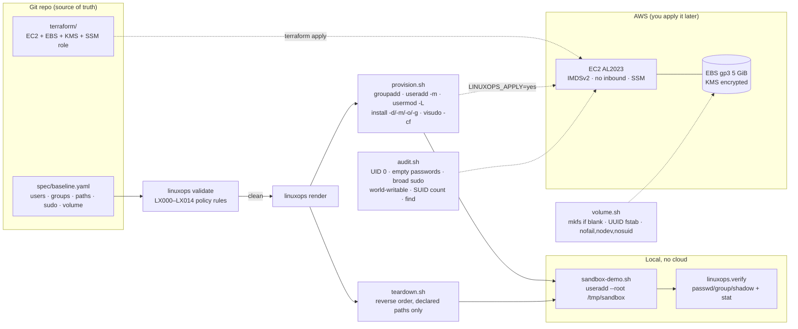

# linux-identity-storage-ops-kit

Declarative Linux access and storage baselines for cloud hosts. You describe users, groups, the directory tree,
ownership and modes, least-privilege sudo, and a dedicated data volume in one YAML spec. `linuxops` checks it
against 14 guardrail rules and renders idempotent Bash to provision and tear down the host. The repo also
includes a read-only host audit script, a safe EBS format-and-mount script, and Terraform for an SSM-only
EC2 lab host with an encrypted 5 GiB data volume.

Day-to-day Linux admin work (useradd, usermod, chown, chmod, setgid directories, sticky bits, sudoers,
mkfs, fstab, `find`, `df -h`) is all here, but as reviewed code instead of one-off shell sessions.

## Architecture



## What the baseline sets up

| Area | Spec | Result |
|---|---|---|
| Groups | `devops` 2001, `aws` 2002, `app` 2003, `database` 2004 | fixed GIDs, plus a private group for `opsadmin` |
| Users | `opsadmin` (+aws), `devops1`/`devops2` (primary `devops`), `appsvc` (nologin), `dbadmin` (+app) | homes 0750, umask 027, passwords locked (SSM / SSH keys only) |
| Shared dirs | `/srv/ops` 2770, `/srv/ops/releases` 2775, `/srv/drop` 1777 | setgid keeps group ownership, sticky bit on the drop dir |
| Private dirs | `/srv/app` 0750, `/srv/db` 0700 | owned by the service/DBA account |
| sudo | `%devops` may restart/status/journal nginx, `%database` may restart postgresql | `NOEXEC`, `use_pty`, `log_output`, validated with `visudo -cf` before install |
| Storage | `/data` ext4, label `data`, 5 GiB | UUID-based fstab entry with `nofail,noatime,nodev,nosuid`, owned `opsadmin:devops` 2770 |

## Guardrail rules

| Rule | Blocks |
|---|---|
| LX000 | unknown spec version or keys |
| LX001 | invalid user, group or host names |
| LX002 | system UIDs/GIDs (<1000), duplicates, private-group collisions |
| LX003 | references to undeclared groups |
| LX004 | non-octal modes, world-writable dirs without the sticky bit |
| LX005 | world-writable or executable config files |
| LX006 | `ALL`, relative paths, shell-escape binaries (bash, vim, less, find, python…) and metacharacters in sudo |
| LX007 | password, secret or key fields in the spec |
| LX008 | relative, non-normalised or system paths (`/etc`, `/usr`, `/boot`…) |
| LX009 | unknown owners/groups, undeclared parent directories |
| LX010 | volume without `nofail`/`nodev`, protected mountpoints, unsupported filesystems |
| LX011 | setuid/setgid files |
| LX013 | shells outside the allow-list, service accounts with a login shell |
| LX014 | duplicate paths |

## Repository layout

```
linuxops/            Python package: spec loader, policy, renderer, verifier, CLI
spec/baseline.yaml   the host baseline
scripts/
  check-all.sh       every offline check
  sandbox-demo.sh    provision -> verify -> teardown inside a /tmp root
  volume.sh          format (only if blank), UUID fstab, mount, chown/chmod; --dry-run
  audit.sh           read-only identity/permission/storage audit, --json, exit 1 on HIGH
terraform/           EC2 lab host, EBS data volume, KMS key, SSM role + mocked tests
tests/               pytest suite
```

## Run it locally

Needs Python 3.11+, Bash, and (for the full check) Terraform >= 1.7. No AWS credentials needed.

```bash
git clone https://github.com/shubhamkhedkar/linux-identity-storage-ops-kit.git
cd linux-identity-storage-ops-kit
python3 -m venv .venv && . .venv/bin/activate
pip install -r requirements-dev.txt checkov pip-audit

python3 -m linuxops validate spec/baseline.yaml      # policy gate
python3 -m linuxops plan spec/baseline.yaml          # JSON summary of the change set
python3 -m linuxops render spec/baseline.yaml provision -o build/provision.sh
python3 -m linuxops render spec/baseline.yaml teardown  -o build/teardown.sh
python3 -m linuxops fstab spec/baseline.yaml         # fstab line for /data

./scripts/check-all.sh                               # ruff, pytest, yamllint, ShellCheck, terraform, Checkov
```

### Sandbox demo (real useradd/chown, host untouched)

```bash
PYTHON=$PWD/.venv/bin/python ./scripts/sandbox-demo.sh
```

It builds a throwaway root under `/tmp`, runs `provision.sh` twice with `ROOT=<sandbox>` to show idempotency
(`useradd --root` and friends only write the sandbox's `/etc/passwd`, `/etc/group` and `/etc/shadow`),
checks every user, group, mode, owner and sudoers file with `linuxops.verify`, runs `teardown.sh`, and
deletes the sandbox. It needs `sudo` because `useradd` and `chown` do.

### Audit a host

```bash
sudo ./scripts/audit.sh --find f3          # table output, exit 1 if anything HIGH
sudo ./scripts/audit.sh --json > audit.json
./scripts/audit.sh --root /some/image/root # audit a mounted image or chroot
```

### Volume plan without touching disks

```bash
./scripts/volume.sh --device /dev/nvme1n1 --mountpoint /data --owner 2101 --group 2001 --mode 2770 --dry-run
```

## Deploy it yourself later

Nothing in this repo has been applied to any account. When you want a real host:

1. **Infrastructure.** Copy `terraform/example.tfvars` to `terraform/lab.tfvars`, set your VPC, private subnet and
   egress CIDRs (VPC endpoint or NAT range), then:
   ```bash
   cd terraform
   terraform init
   terraform plan -var-file=lab.tfvars -out=lab.plan
   terraform apply lab.plan
   ```
   You get an AL2023 instance (IMDSv2, no inbound rules, no key pair, detailed monitoring, KMS-encrypted root)
   and a 5 GiB gp3 volume in the same AZ, attached as `/dev/sdf` (`/dev/nvme1n1` on Nitro).
2. **Connect.** `aws ssm start-session --target $(terraform output -raw instance_id)`
3. **Copy the kit** to the host (git clone over HTTPS egress, or `aws s3 cp`) and render the scripts there.
4. **Identity and paths.** `sudo LINUXOPS_APPLY=yes bash build/provision.sh`, then
   `sudo python3 -m linuxops.verify spec/baseline.yaml /`.
5. **Data volume.** `lsblk` to confirm the device, then
   `sudo ./scripts/volume.sh --device /dev/nvme1n1 --mountpoint /data --owner 2101 --group 2001 --mode 2770`
   and check that `df -h /data` shows the new filesystem.
6. **Access.** Add SSH public keys to `~/.ssh/authorized_keys` if you need SSH; otherwise use SSM with IAM-based
   access. The accounts are locked and have no passwords by design.
7. **Audit.** `sudo ./scripts/audit.sh --find f3` and keep the JSON as evidence.

## Limitations

- Targets one host per spec. For fleets, wrap the rendered scripts in SSM Run Command or Ansible.
- No ACL (`setfacl`) or SELinux context management yet; group ownership and setgid cover shared access.
- `volume.sh` was only run in `--dry-run` mode here. Real `mkfs`/`mount` behaviour was not exercised.
- The Terraform was validated and plan-tested against a mocked AWS provider, never applied.
- Teardown deletes the declared paths recursively, so anything users added under them is removed too.

## Cleanup

- Host: `sudo LINUXOPS_APPLY=yes bash build/teardown.sh`, then
  `sudo ./scripts/volume.sh --mountpoint /data --unmount` (removes the fstab entry and `/data`).
- AWS: `cd terraform && terraform destroy -var-file=lab.tfvars` (detaches and deletes the volume, terminates the
  instance, schedules the KMS key for deletion after 7 days).
- Local: the sandbox demo cleans up after itself; `rm -rf .venv build terraform/.terraform`.

## Credits

Inspired by [DevOps-Project-03](https://github.com/NotHarshhaa/DevOps-Projects/tree/master/DevOps-Project-03)
in [NotHarshhaa/DevOps-Projects](https://github.com/NotHarshhaa/DevOps-Projects), a hands-on Linux user,
permission, file system and EBS exercise. This repo is an independent implementation: spec-driven, policy-checked,
idempotent, tested in a sandbox, with infrastructure as code.

## License

MIT
